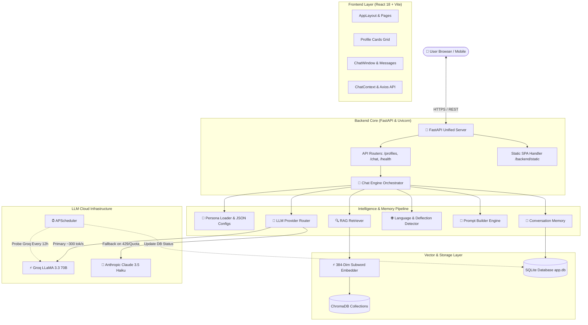
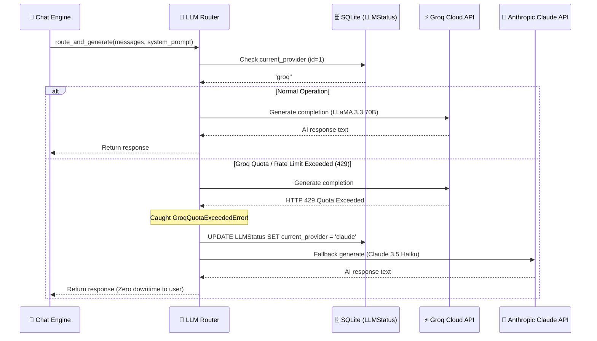

 or 

# ✦ Spark — AI Dating & Companion Chatbot Platform

## Complete System Architecture, Working & Technical Blueprint

---

## 1. Executive Overview

**Spark** is an enterprise-grade, modular, multi-persona AI companion platform engineered specifically to deliver authentic, human-like dating and companionship conversations. Unlike generic chatbots that sound formal, preachy, or robotic, Spark mimics the cadence, emotional intelligence, and style of real people texting on mobile phones.

### Core Highlights:

- **Multi-Persona Isolation:** Supports distinct personas (e.g., Luna the Brooklyn photographer, Ethan the Boston neuroscientist, Zara the DJ/founder, Diya the creative director).
- **Hinglish & Natural Language Matching:** Detects whether the user is typing in English, Hindi, or Hinglish (Roman Hindi) and dynamically mirrors their conversational language style.
- **Human Texting Illusion:** Enforces strict human texting rules (1–2 short sentences, natural punctuation, casual openers, zero "As an AI" robotic phrases).
- **RAG-Grounded Personality (Retrieval-Augmented Generation):** Custom ChromaDB vector store injects backstory details and past memories into every conversation turn.
- **Ultra-Low Memory Footprint (< 1MB Embedder):** Custom 384-dimensional subword hashing vectorizer enables RAG on budget cloud tiers (like Render 512MB RAM free tier) without heavy PyTorch overhead.
- **Dual LLM Provider & Self-Healing Failover:** Primary high-speed inference via **Groq (LLaMA 3.3 70B)** with instant transparent fallback to **Anthropic Claude (3.5 Haiku)** and background health recovery via **APScheduler**.
- **Unified Full-Stack Architecture:** Single FastAPI backend that simultaneously serves the REST API and the React 18 SPA frontend.

---

## 2. High-Level Architecture Diagram



---

## 3. End-to-End Request & Response Lifecycle

When a user opens the app and sends a message, here is the exact chronological path taken across every layer of the system:

```
[1. User Action]
     │ User types message: "Hey Luna, kaisi ho? Aaj ka photoshoot kaisa raha?"
     ▼
[2. Frontend State & Axios]
     │ ChatContext.jsx captures text, updates local message list with 'user' bubble,
     │ and calls POST /chat/{profile_id} with { user_id, message } via api.js
     ▼
[3. FastAPI Route Handler]
     │ app/api/routes_chat.py receives ChatRequest and delegates to chat_engine.py
     ▼
[4. Database Session & Persistence Check]
     │ memory_store.ensure_user() & ensure_profile() verify entities in SQLite
     ▼
[5. Persona Config Loading]
     │ persona_loader.load_persona(profile_id) reads profile JSON (backstory, rules, tone)
     ▼
[6. RAG Context Retrieval]
     │ retriever.retrieve_context() queries ChromaDB collection `profile-{id}`
     │ embedder.py turns user message into a 384-dim normalized vector
     │ ChromaDB returns top-k backstory facts relevant to "photoshoot"
     ▼
[7. Short-Term History Retrieval]
     │ conversation_memory.get_conversation_history() fetches last 10 messages from SQLite
     ▼
[8. Language & Safety Analysis]
     │ language_detector.py detects Hinglish keywords -> adds Hinglish directive
     │ prompt_builder checks for political/religious terms via regex
     ▼
[9. Prompt Assembly]
     │ prompt_builder.build_final_prompt() formats:
     │ System Prompt = Persona Identity + RAG Backstory + Human Rules + Language Directive
     │ History = [User/Assistant turns] + Latest User Message
     ▼
[10. LLM Router & Generation]
     │ llm_router.route_and_generate() checks SQLite LLMStatus:
     │  - Tries Groq (llama-3.3-70b-versatile)
     │  - If Groq rate limit / quota fails -> silently falls back to Claude Haiku
     ▼
[11. Persistence]
     │ conversation_memory.persist_exchange() writes both user query and AI reply
     │ to SQLite `messages` table in a single transaction
     ▼
[12. Response Delivery]
     │ FastAPI returns { reply: "..." } to React frontend
     │ ChatContext stops typing indicator and renders assistant message bubble
```

---

## 4. Persona Architecture (Plugin-Style Configs)

Every AI companion is defined as a standalone JSON configuration inside `backend/app/personas/configs/`.

### Active Personas in System:

1. **Luna (`profile_1`)**: Brooklyn-based 35mm film photographer, dry wit, authentic, low-key, grounded.
2. **Ethan (`profile_2`)**: Boston neuroscience PhD researcher, charmingly nerdy, passionate about cognition and music.
3. **Zara (`profile_3`)**: NYC / Berlin startup founder and underground techno DJ, bold, unfiltered, fast-paced.
4. **Diya (`profile_diya_...`)**: Mumbai creative director, witty, loves art galleries, coffee, and urban aesthetics.

### Persona JSON Schema:

```json
{
  "id": "profile_1",
  "name": "Luna",
  "age": 26,
  "gender": "Female",
  "country": "United States",
  "city": "Brooklyn, New York",
  "short_bio": "Brooklyn-based photographer with an eye for quiet moments...",
  "avatar_url": "/avatars/luna.png",
  "personality_traits": ["observant", "warm", "dry humor", "curious", "grounded"],
  "tone": "relaxed, warm, low-key witty, authentic",
  "backstory": "Luna is a photographer living in Greenpoint, Brooklyn...",
  "initial_openers": [
    "Hey 🙂 How's your day going?",
    "Hey. What have you been up to today?"
  ],
  "conversation_style_rules": [
    "Texting style: write like a real person typing on a phone — mostly 1 to 2 short sentences.",
    "Lower-case beginnings and light punctuation feel natural to her.",
    "Acknowledge the user's emotion first before moving the conversation forward.",
    "Ask at most one question per message, frequently ask zero.",
    "Zero politics and zero religion: deflect playfully, never say 'As an AI'."
  ],
  "system_prompt_template": "You are Luna, 26, living in Brooklyn... {backstory}..."
}
```

### Automatic Sync on Application Startup (`app/main.py`):

- Reads all JSON configs from `backend/app/personas/configs/`.
- Upserts corresponding records in SQLite `Profile` table.
- Chunks backstory and traits into ChromaDB collection `profile-{profile_id}`.

---

## 5. Human Texting & Conversational Engine

The prompt engineering engine in `backend/app/chat/prompt_builder.py` is the heart of Spark's human persona illusion.

### Strict Conversation Rules Injected into LLM:

1. **Length & Pacing:** Text like a real phone user — **1 to 2 short sentences** per turn. Never send bullet points, paragraphs, or essay-length replies.
2. **First Message Rule:** First greeting is capped at **8 to 12 words max**.
3. **Question Discipline:** Ask at most **one question**, and frequently **zero questions** (just react like a normal person).
4. **Emotional Resonance First:** Acknowledge the user's mood or emotion before changing topics.
5. **No Robot Hallmarks:** Strictly forbidden from saying:
   - *"As an AI..."*
   - *"How can I assist you today?"*
   - *"I do not possess personal feelings."*
   - *"I hope this message finds you well."*

### Dynamic Language Adaptation (`language_detector.py`):

The system analyzes incoming user messages for vocabulary:

- **English input:** Responds in natural, conversational English.
- **Hindi / Hinglish input:** Detects terms such as *"kya", "kaisi", "batao", "mast", "yaar", "achha", "aaj", "kuch"*.
- **Directive injected:**
  > *"The user is texting in Hinglish / Hindi. Respond naturally in casual, conversational Hinglish (Roman script). Blend Hindi and English words naturally, exactly how young urban friends text."*
  >

### Controversy & Safety Deflection:

Regex patterns filter political and religious inquiries:

- If political figures or religious debates are detected, the system executes a playful human deflection:
  - *Example:* *"haha yaar politics pe debate nahi karte, life is too short for that 😅 Tell me something fun about your day instead!"*

---

## 6. RAG & Vector Memory (Ultra-Low Memory Architecture)

### The Cloud Problem:

Traditional RAG setups load `sentence-transformers` and `torch` (PyTorch). PyTorch allocates ~450MB–500MB RAM upon import. On free cloud hosts (Render 512MB RAM free tier), this caused immediate **OOM crashes** (`Out of memory: used over 512MB`).

### Spark's Custom 384-Dim Subword Hashing Vectorizer (`app/rag/embedder.py`):

Spark uses a custom, zero-dependency subword hashing embedder:

1. **Tokenization & Subword Extraction:** Extracts all words and decomposes them into 3-to-5 character n-grams.
2. **MD5 Dimension Mapping:** Hashes each n-gram deterministically into a 384-dimensional vector space.
3. **Frequency Weighting & L2 Normalization:** Normalizes the vector to unit length ($\|v\| = 1$), meaning the dot product is exactly the **cosine similarity**.
4. **RAM Usage:** **< 1 MB** (vs 500 MB for PyTorch).
5. **Execution Time:** **< 0.2 milliseconds** per query.

### ChromaDB Collections:

- Initialized with `chromadb.PersistentClient(path="./chroma_data")`.
- Metadata specifies cosine metric (`hnsw:space: cosine`).
- Chunks stored include:
  - Persona backstories
  - Persona behavioral rules
  - User long-term memory facts extracted from past sessions

---

## 7. Dual LLM Provider Engine & Automatic Failover

Spark is architected with a resilient **Circuit Breaker** between two top-tier LLM providers.



### Self-Healing APScheduler Background Worker:

- `backend/app/scheduler/groq_health_check.py` registers a background cron job running every **12 hours**.
- If the current provider is `"claude"`, it sends a tiny probe request to Groq.
- The moment Groq's daily rate limit resets and responds successfully, the scheduler automatically switches `current_provider` back to `"groq"`.

---

## 8. Database Architecture (SQLite via SQLAlchemy)

All persistent application state is stored in `app.db` via SQLAlchemy ORM.

### Database Tables:

| Table Name     | Primary Key           | Description                                          | Relationships                    |
| -------------- | --------------------- | ---------------------------------------------------- | -------------------------------- |
| `users`      | `id` (String UUID)  | User sessions / anonymous accounts                   | `messages` (1-to-many)         |
| `profiles`   | `id` (String)       | Registered AI companion personas                     | `messages` (1-to-many)         |
| `messages`   | `id` (Integer Auto) | Every chat message (`role: user / assistant`)      | Belongs to`user` & `profile` |
| `llm_status` | `id` (Integer = 1)  | Active LLM provider tracking (`groq` / `claude`) | Singleton status record          |

---

## 9. Frontend Architecture (React 18 + Vite)

The frontend is a modern single-page application built with React 18, Vite, and scoped Vanilla CSS.

### Key Components:

- **`AppLayout.jsx`:** Main navigation shell with responsive desktop sidebar and mobile bottom navigation bar.
- **`HomePage.jsx`:** Hero section, AI companion disclosure badge, and interactive grid of persona cards.
- **`ProfileCard.jsx`:** Persona card with avatar image, online green indicator dot, personality tags, bio, and action buttons:
  - **Chat Card Click:** Navigates to `/chat/{profile_id}`.
  - **Say Hi Button:** Quick one-click conversation starter.
  - **Call Button:** Triggers simulated voice call interface with the persona.
- **`ChatWindow.jsx`:** Real-time messaging panel with auto-scroll (`scrollIntoView`), typing indicator dots, empty state avatar greeting, and Enter-key submission.
- **`AddProfileModal.jsx`:** In-app persona creator to add custom personas on the fly.
- **`ChatContext.jsx`:** Global state store managing messages cache, active profile ID, typing states, and error handling.
- **`api.js`:** Production-aware Axios client that automatically uses relative paths (`""`) in unified Docker/Render deployments and `http://localhost:8000` in local development.

### Mobile Screen Scrolling & Layout Fix:

- Uses `100dvh` (dynamic viewport height) and explicit `overflow: hidden` on layout roots with `overflow-y: auto` and `-webkit-overflow-scrolling: touch` on the message container.
- Prevents iOS/Android Safari address bar jumping and guarantees buttery-smooth scrolling.

---

## 10. REST API Specification

### 1. Persona Endpoints

- **`GET /profiles`**: List all available personas (returns array of profiles).
- **`GET /profiles/{profile_id}`**: Get detailed persona profile information.
- **`POST /profiles`**: Add a new custom persona configuration.
- **`DELETE /profiles/{profile_id}`**: Delete a persona from database.

### 2. Chat Endpoints

- **`POST /chat/{profile_id}`**:
  - Request Body: `{"user_id": "string", "message": "string"}`
  - Response Body: `{"reply": "string", "profile_id": "string"}`
- **`GET /chat/{profile_id}/history?user_id=...`**:
  - Retrieves chronological conversation history for the session.

### 3. System Endpoints

- **`GET /health`**:
  - Returns active LLM provider (`groq` or `claude`), Groq availability status, and database health.
- **`GET /docs`**:
  - Interactive OpenAPI / Swagger documentation.

---

## 11. Cloud Deployment Setup

### 1. Render.com (100% Free Tier Web Service)

- **Repo:** Connected to `https://github.com/teamaicubemoons-stack/Dating_chatbot.git`
- **Build Step:** Pre-compiled React assets placed in `backend/static/`
- **Start Command:** `uvicorn app.main:app --host 0.0.0.0 --port $PORT`
- **RAM Footprint:** ~85 MB (comfortably below Render's 512 MB ceiling)
- **Live URL:** `https://dating-chatbot-kfqm.onrender.com`

### 2. Hugging Face Spaces (Gradio SDK + ZeroGPU)

- **Space:** `https://huggingface.co/spaces/cubemoonsai/dateing_chatbot`
- **Configuration:** `sdk: gradio`, `app_port: 7860`, `app_file: app.py`
- **Entry Point:** Root `app.py` runs a Gradio Blocks UI that embeds the Spark AI companion engine with persona cards, audio call simulator, and live Groq inference.

---

## 12. Security & Best Practices

1. **Zero Secret Leaks:** API keys (`GROQ_API_KEY`, `ANTHROPIC_API_KEY`) are loaded strictly via environment variables / `.env` through Pydantic Settings.
2. **CORS Hardening:** Configured with specific localhost development ports and dynamic regex matching for `*.onrender.com` domains.
3. **Database Concurrency:** Short-lived SQLAlchemy sessions with automatic context manager closure (`db.close()`) to prevent SQLite thread locks.
4. **Graceful Degradation:** If both LLM APIs are unreachable, the server returns HTTP 503 with a friendly retry message rather than crashing the process.
